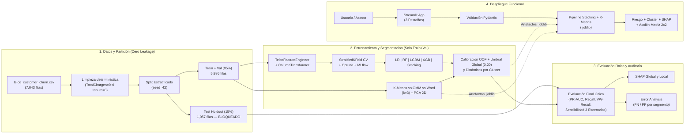

# Proyecto Integrador: Sistema Predictivo de Fuga de Clientes con Segmentación de Valor (Customer Churn)

**Curso:** Data Mining Tools – CC209  
**Docente:** Carlos Fernando Montoya Cubas  
**Institución:** Universidad Peruana de Ciencias Aplicadas (UPC)  
**Hito:** Trabajo Final (TF1) – Semana 15 (Evolución integral desde TP1 – Semana 7)  
**Modalidad:** Trabajo grupal  
**Integrantes:** Joaquin Basas Requena, Fabian Marcelo Rojas Cuadros, Cielo Luwidka Chavez Merino, Rodrigo Alonso Gamero Vera  

---

## 1. Definición del problema y criterios de éxito

### 1.1 Contexto y necesidad

El proyecto aborda la **deserción de clientes (*customer churn*)** en telecomunicaciones. El objetivo de negocio es identificar con anticipación qué clientes presentan mayor riesgo de cancelar su servicio y cruzar ese riesgo con su perfil de valor para **priorizar acciones preventivas rentables y evitar campañas indiscriminadas sobre toda la cartera**.

### 1.2 Unidad de análisis y pregunta principal

- **Unidad de análisis:** Un cliente/contrato individual registrado en la base.
- **Tipo de problema:** Clasificación binaria supervisada con desbalance moderado (`26.54%` churn vs. `73.46%` retención), complementada con segmentación no supervisada por perfiles de valor y reducción dimensional.
- **Pregunta principal:**

> ¿Qué clientes presentan mayor probabilidad de fuga, qué variables contractuales, de servicio y facturación explican ese riesgo a nivel global e individual, y cómo combinar riesgo con valor del cliente para maximizar el retorno económico neto de las campañas de retención?

### 1.3 Cumplimiento de criterios de utilidad (TP1 vs. TF1 en Test Holdout)

| Criterio definido por el equipo | Meta | Resultado TP1 (`RF 0.50`) | Resultado TF1 (`Stacking τ*=0.20`) | Estado TF1 |
| :--- | :---: | :---: | :---: | :---: |
| **Discriminación sobre baselines** | `PR-AUC > 0.60` | `0.6698` | **`0.6719`** | Cumplido |
| **Cobertura de clientes en fuga** | `Recall >= 0.75` | `0.7046` *(No cumplido)* | **`0.8114`** | **Cumplido** |
| **Rescate de ingresos mensuales en riesgo** | `Value-Weighted Recall` | `0.7411` | **`0.8412`** | **Cumplido** |
| **Utilidad económica neta simulada** | `> $0` | `+$20,500` | **`+$41,600`** *(2.03× TP1)* | **Cumplido** |

---

## 2. Dataset, procedencia y licencia

- **Dataset:** Telco Customer Churn (`data/raw/telco_customer_churn.csv`).
- **Fuente:** IBM Cognos Analytics Sample Data Sets / Kaggle (`blastchar/telco-customer-churn`).
- **Dimensiones:** `7,043` observaciones y `21` columnas originales (`19` predictores útiles + `customerID` excluido + target `Churn`).
- **Licencia / condiciones de uso:** Conjunto de datos de muestra pública de **IBM Sample Data Sets** distribuido en Kaggle para **fines educativos, académicos y demostrativos** (uso libre no comercial y reproducción en proyectos de ciencia de datos sin información personal identificable real).
- **Calidad de datos:** Se detectaron `11` registros con `TotalCharges` vacío que corresponden exclusivamente a clientes nuevos (`tenure = 0`), por lo que se representan determinísticamente como `TotalCharges = 0.0` (regla de negocio). No existen filas duplicadas. `SeniorCitizen` se trata como categoría binaria (`"0"` / `"1"`).

---

## 3. Evolución respecto al TP1 (Tabla obligatoria Sección 5.2.1)

| Elemento | Estado en TP1 (Semana 7) | Evolución en TF1 (Semana 15) | Motivo técnico / evidencia del cambio |
| :--- | :--- | :--- | :--- |
| **Preparación y gobernanza** | `ColumnTransformer` básico en notebooks y `src/preprocessing.py`. | `TelcoFeatureEngineer` + `ColumnTransformer` (`verbose_feature_names_out=False`) + validación estricta con **Pydantic v2** (`src/schemas.py`) y pruebas `pytest`. | Prevenir errores de esquema en inferencia real, exponer nombres legibles para SHAP y asegurar reproducibilidad mediante tests automatizados. |
| **Variables** | `19` atributos originales crudos (`3` numéricos, `16` categóricos). | `+8` variables de dominio sin leakage (`TotalServicesSubscribed`, `BillingRatio`, `AvgMonthlyCharge`, `ChargeDelta`, `HighRisk_Fiber_No_Support`, `AutoPayFlag`, `ContractRiskTier`, `TenureBucket`). | Capturar interacciones clave observadas en el EDA (Fibra sin soporte, carga tarifaria relativa y tramos tempranos de antigüedad). |
| **Esquema de validación** | Split único `70% Train / 15% Val / 15% Test`. | `StratifiedKFold (k=5)` para Optuna y `StratifiedKFold (k=10)` sobre `Train+Val` (`5,986` filas); `Test` (`1,057` filas) intacto hasta evaluación final única. | En TP1 la diferencia de `0.0014` en `PR-AUC` sobre un solo split no era concluyente; CV 10-fold permite reportar $\mu \pm \sigma$ y prueba estadística de Wilcoxon. |
| **Modelos candidatos** | Regresión Logística y Random Forest con hiperparámetros manuales (`depth=10`). | `LogisticRegression`, `RandomForest`, `LightGBM`, `XGBoost` optimizados con **Optuna** + **Stacking Heterogéneo (`LR+LGBM+XGB`)** vs. 2 baselines. | Aprovechar *Gradient Boosting* en datos tabulares y combinar fronteras lineales con no lineales para maximizar `PR-AUC` (`0.6732` en CV10). |
| **Experimentación y tracking** | Ejecución por consola sin registro histórico de trials. | Optimización bayesiana (`Optuna`, 25 trials/familia) + registro trazable en **MLflow local** exportado a `reports/mlflow_experimentos_tf1.csv`. | Garantizar auditabilidad completa de parámetros, semillas y métricas entre corridas. |
| **Calibración y umbral** | Umbral fijo `0.50` (`Recall Test = 70.5%`, por debajo de la meta `75%`). | Auditoría de calibración OOF (`none` vs `sigmoid` vs `isotonic`), umbral global operativo $\tau^* = 0.20$ (`Recall>=75% & Prec>=50%`) y umbrales dinámicos por cluster (`0.30 / 0.22 / 0.21`). | Resolver el incumplimiento de Recall en Test evitando que el óptimo Bayesiano irrestricto (`0.05`) dispare campañas masivas sobre el `75%` de la cartera. |
| **Métricas** | Métricas estándar + utilidad base (`-$500 / -$50 / +$350`). | Se añaden **Value-Weighted Recall**, `Brier Score`, `Log-Loss` y **análisis de sensibilidad económica** en 3 escenarios. | Medir porcentaje de dólares mensuales en riesgo rescatados y verificar robustez financiera si la campaña tiene 30% de efectividad o doble costo FP. |
| **Técnica adicional** | Ninguna. | Comparativa **K-Means vs. GMM vs. Jerárquico (Ward)** + **PCA 2D** (`96.17%` varianza) para perfiles de valor y Matriz de Acción 2×2. | Diferenciar la acción comercial entre clientes de alto valor en riesgo y clientes de bajo margen. |
| **Interpretabilidad y errores** | Solo exploración global del EDA. | **SHAP** global (Beeswarm/Bar) y local (Waterfall en TP, FN, FP críticos) + auditoría profunda de los `53` FN y `234` FP por subgrupos. | Explicar razones de riesgo al equipo comercial y diagnosticar en qué segmentos falla el modelo. |
| **Aplicación / despliegue** | Scripts en terminal (`python -m src.train_models`). | Aplicación web interactiva en **Streamlit** (`app/streamlit_app.py`) con 3 pestañas conectadas a los artefactos `.joblib`. | Habilitar uso operativo fuera del notebook (scoring individual, por lotes y simulación ejecutiva). |

---

## 4. Arquitectura de la solución



---

## 5. Matriz de decisiones de herramientas (Sección 6)

| Necesidad | Herramienta elegida | Alternativa considerada | Justificación técnica |
| :--- | :--- | :--- | :--- |
| **EDA** | `pandas` + `matplotlib` / `seaborn` | Profiling automático (`ydata-profiling`) | Permite responder hipótesis específicas de negocio y acompañar cada gráfico con interpretación crítica. |
| **Preparación y Contratos** | `TelcoFeatureEngineer` + `ColumnTransformer` + `Pydantic v2` | `get_dummies` manual / sin validación | Encapsula transformaciones sin leakage (`fit` solo en entrenamiento/folds) y valida esquemas y reglas de negocio antes de inferencia. |
| **Modelamiento** | `StackingClassifier` (`LogisticRegression` + `LightGBM` + `XGBoost`) + `RandomForest` | Árbol individual / un único modelo lineal | Combina la calibración lineal de LR con las interacciones no lineales de *Gradient Boosting*, logrando el mayor `PR-AUC` y `ROC-AUC` en CV 10-fold. |
| **Experimentación y Tracking** | `StratifiedKFold (k=10)` + `Optuna` (TPE) + `MLflow` local (SQLite + CSV) | GridSearch exhaustivo / un solo split | Optuna explora eficientemente espacios continuos y discretos; CV 10-fold mide estabilidad ($\mu \pm \sigma$); MLflow + CSV aseguran trazabilidad portable. |
| **Técnica adicional** | `K-Means (k=3)` (comparado frente a `GMM` y `Ward`) + `PCA 2D` | Segmentación por cuantiles univariados / DBSCAN | K-Means obtuvo el mayor `Silhouette Score` (`0.4394`) en el rango accionable ($k \in \{3, 4\}$), permite `.predict()` online en Streamlit y se proyecta en PCA 2D con `96.17%` de varianza explicada. |
| **Interpretabilidad** | `SHAP` (`PermutationExplainer` en espacio preprocesado) | Importancia Gini / coeficientes lineales aislados | Proporciona atribución consistente global y local (*Waterfall*) compatible directamente con ensambles heterogéneos (`Stacking`). |
| **Despliegue y Pruebas** | `Streamlit` + `Plotly` + `pytest` | API REST desacoplada / notebooks sin interfaz | Permite entregar una herramienta visual inmediata para usuarios de negocio en 3 pestañas, validada automáticamente con `AppTest` y `pytest`. |

---

## 6. Resultados experimentales y evaluación final

### 6.1 Ablation Study (CV 5-fold sobre Train+Val)

- `LogisticRegression`: `PR-AUC = 0.6566 ± 0.0239` (sin FE) $\rightarrow$ **`0.6602 ± 0.0220`** (con `TelcoFeatureEngineer`).
- `LightGBM` base: `PR-AUC = 0.6462 ± 0.0164` $\rightarrow$ `0.6428 ± 0.0088` (reducción de desviación estándar a la mitad).

### 6.2 Comparativa en `StratifiedKFold (k=10)` sobre Train+Val (`5,986` filas)

| Modelo | PR-AUC ($\mu \pm \sigma$) | ROC-AUC ($\mu$) | Brier Score ($\mu$) | Wilcoxon vs. Top-1 ($p$-value) |
| :--- | :---: | :---: | :---: | :---: |
| **Stacking Heterogéneo (`LR+LGBM+XGB`)** | **`0.6732 ± 0.0289`** | **`0.8515`** | `0.1333` | Referencia |
| `XGBoost (Optuna)` | `0.6724 ± 0.0278` | `0.8513` | **`0.1330`** | `0.6953` *(No sig.)* |
| `LightGBM (Optuna)` | `0.6716 ± 0.0287` | `0.8508` | `0.1603` | `0.3223` *(No sig.)* |
| `Regresión Logística (Optuna)` | `0.6664 ± 0.0332` | `0.8483` | `0.1342` | **`0.0273`** *(Sig.)* |
| `Random Forest (Optuna)` | `0.6633 ± 0.0311` | `0.8472` | `0.1347` | **`0.0020`** *(Sig.)* |
| `Baseline Heurístico (Mes-a-Mes & Tenure<=6)` | `0.3837 ± 0.0191` | `0.6454` | `0.2459` | — |
| `Baseline Trivial (Dummy)` | `0.2653 ± 0.0006` | `0.5000` | `0.2653` | — |

### 6.3 Calibración y optimización de umbral OOF

- **Calibración OOF:** `Sin calibrar (none)` obtuvo `Brier Score = 0.13331` (`Log-Loss = 0.41311`), superando levemente a Platt (`0.13346`) e Isotónica (`0.13357`) gracias al meta-estimador logístico del Stacking.
- **Paradoja Bayesiana vs. Selectividad Operativa:** Bajo la relación de costos `FN=$500` vs. `FP=$50` (`TP=+$350`), el óptimo Bayesiano irrestricto cae en $\tau = 0.05$, lo que obligaría a contactar al **75.7%** de la cartera (`Precision = 34.5%`), contradiciendo la meta de evitar campañas masivas. Al imponer la restricción operativa `Recall >= 75%` y `Precision >= 50%` en OOF, se selecciona **$\tau^*_{\text{global}} = 0.20$** (`Recall OOF = 84.5%`, `Precision = 50.2%`, `Value-Weighted Recall = 86.0%`).
- **Umbrales dinámicos por cluster (OOF):** `C0 Bajo Valor = 0.30`, `C1 Valor Medio = 0.22`, `C2 Alto Valor = 0.21`.

### 6.4 Evaluación final ÚNICA en Test Holdout (`1,057` filas)

| Modelo / Política en Test | PR-AUC | ROC-AUC | Recall | Value-Weighted Recall | Precision | F1 | Utilidad Neta ($) |
| :--- | :---: | :---: | :---: | :---: | :---: | :---: | :---: |
| Baseline Trivial (Dummy) | `0.2658` | `0.5000` | `0.0000` | `0.0000` | `0.0000` | `0.0000` | `-$140,500` |
| Baseline Heurístico | `0.3999` | `0.6596` | `0.4377` | `0.3729` | `0.5721` | `0.4960` | `-$40,550` |
| TP1: Random Forest (`depth=10`, `τ=0.50`) | `0.6698` | `0.8400` | `0.7046` | `0.7411` | `0.5756` | **`0.6336`** | `+$20,500` |
| TF1: Stacking (`τ=0.50` sin ajustar) | **`0.6719`** | **`0.8443`** | `0.5089` | `0.5495` | **`0.6714`** | `0.5789` | `-$22,450` |
| **TF1: Stacking (Umbral Global `τ*=0.20`)** | **`0.6719`** | **`0.8443`** | **`0.8114`** | **`0.8412`** | `0.4935` | `0.6137` | **`+$41,600`** |
| TF1: Stacking (Umbrales Dinámicos Cluster) | **`0.6719`** | **`0.8443`** | `0.7651` | `0.8198` | `0.5095` | `0.6117` | `+$31,900` |

### 6.5 Sensibilidad económica en Test (3 escenarios)

| Modelo | Base (`TP=+350, FN=-500, FP=-50`) | Pesimista 30% efect. (`TP=+105`) | Agresivo (`FP=-100`) |
| :--- | :---: | :---: | :---: |
| Baseline Dummy | `-$140,500` | `-$140,500` | `-$140,500` |
| Baseline Heurístico | `-$40,550` | `-$70,685` | `-$45,150` |
| TP1 Random Forest (`0.50`) | `+$20,500` | `-$28,010` | `+$13,200` |
| **TF1 Stacking (`τ*=0.20`)** | **`+$41,600`** | **`-$14,260`** | **`+$29,900`** |
| TF1 Stacking (Dinámicos) | `+$31,900` | `-$20,775` | `+$21,550` |

En los tres escenarios —incluido el régimen pesimista donde toda retención parcial reduce márgenes— la política TF1 mantiene la mejor posición financiera absoluta.

---

## 7. Segmentación de valor (Clustering + PCA 2D)

Sobre `Train + Val` (`PowerTransformer` + variables `tenure`, `MonthlyCharges`, `TotalCharges`, `TotalServicesSubscribed`), **K-Means (`k=3`)** obtuvo el mejor **Silhouette (`0.4394`)** dentro del rango accionable $k \in \{3, 4\}$ (frente a `0.4006` de GMM y `0.4154` de Jerárquico Ward), con **96.17%** de varianza explicada en **PCA 2D**.

| Cluster (Proxy de Valor) | Clientes (`Dev`) | `% Cartera` | Tenure Medio | Cargo Mensual | Servicios Medios | Churn Observado | Acción Matriz Riesgo × Valor (si Alto Riesgo) |
| :--- | :---: | :---: | :---: | :---: | :---: | :---: | :--- |
| **C0: Bajo Valor / Entrada** | `1,539` | `25.7%` | `28.8 m` | `$23.06` | `1.16` | `10.1%` | Retención digital automatizada de bajo costo |
| **C1: Valor Medio / Estándar** | `1,888` | `31.5%` | `9.1 m` | `$70.11` | `3.42` | **`50.1%`** | Bono de soporte técnico / migración contractual |
| **C2: Alto Valor / Consolidado** | `2,559` | `42.7%` | `51.6 m` | `$86.53` | `5.53` | `19.0%` | **Prioridad P1 VIP:** llamada ejecutiva + oferta anual |

*(Nota: los segmentos son perfiles/proxies basados en facturación y vinculación contractual disponibles en la muestra; no representan un RFM o CLV contable real.)*

---

## 8. Interpretabilidad SHAP y análisis de errores

### 8.1 SHAP Global y Local
- Principales impulsores globales (`mean |SHAP|`): `tenure` (`0.0753`), `ContractRiskTier` (`0.0656`), `InternetService_Fiber optic` (`0.0379`), `OnlineSecurity_No` (`0.0306`), `PaymentMethod_Electronic check` (`0.0219`), `PaperlessBilling_Yes` (`0.0194`), `TechSupport_No` (`0.0161`) y `HighRisk_Fiber_No_Support` (`0.0149`).
- Precaución: SHAP mide atribución marginal dentro del modelo, **no causalidad**.

### 8.2 Auditoría de Errores en Test (`53` FN, `234` FP, `228` TP, `542` TN con `τ*=0.20`)
- **Falsos Negativos (`n = 53`):** Presentan antigüedad promedio elevada (`31.0` meses vs. `14.0` en TP) y el **`58.5%` posee contratos de 1 o 2 años** (`Recall` cae a `21.2%` en `One year` y `0.0%` en `Two year`), mientras que en `Month-to-month` el modelo logra `Recall = 90.9%`, en `Fiber optic` `91.3%` y en el Cluster Valor Medio `94.1%`.
- **Falsos Positivos (`n = 234`):** El `91.5%` tiene contrato mes a mes, `63.2%` usa fibra óptica y `72.6%` carece de soporte técnico (`P(Churn)` media = `0.417`). Son perfiles idénticos a los desertores dentro de los atributos estáticos disponibles, lo que sugiere factores latentes de lealtad o calidad no observados.

---

## 9. Conclusiones y limitaciones (Sección 5.2.9)

1. **¿Qué puede concluirse a partir del proyecto?**
   - Combinar variables de dominio sin leakage, optimización bayesiana con `StratifiedKFold`, ensamble heterogéneo (`Stacking`) y ajuste operativo de umbral ($\tau^*=0.20$) supera consistentemente al TP1 y a ambos baselines: eleva el `Recall` en Test de `70.5%` a **`81.1%`**, rescata el **`84.1%` de los ingresos mensuales en riesgo** y duplica la utilidad económica simulada (`+$41,600` vs. `+$20,500`), manteniéndose superior bajo los tres escenarios de sensibilidad.
   - Los drivers del modelo (`tenure`, contrato mensual, fibra óptica sin soporte/seguridad, cheque electrónico) son coherentes con el EDA y permiten accionar mediante `SHAP` y `K-Means` en Streamlit.
2. **¿Qué NO puede concluirse?**
   - No pueden inferirse **relaciones causales** (que regalar soporte técnico reduzca automáticamente el churn en un porcentaje exacto sin un experimento A/B controlado).
   - No puede afirmarse que la ganancia simulada (`+$41,600`) represente utilidad contable real ni que los clusters constituyan un **CLV o RFM transaccional completo**.
3. **¿Cuáles son las principales limitaciones de los datos y del modelo?**
   - **Datos:** Corte transversal estático (`7,043` filas de muestra IBM Telco), sin series temporales de consumo, historial de tickets de soporte, NPS, caídas de red ni distinción entre churn voluntario e involuntario (morosidad).
   - **Modelo:** Baja capacidad predictiva en clientes con contratos largos (`One year` / `Two year`, `58.5%` de los FN) donde los detonantes de fuga son externos a los atributos estáticos del contrato.
4. **¿Qué riesgos tendría utilizar la solución fuera del contexto analizado?**
   - **Despliegue en otra operadora o mercado:** *Covariate shift* en precios, monedas, planes y tasas base de churn (invalidando $\tau^*=0.20$ sin recalibración).
   - **Uso para decisiones punitivas o de cobranza:** El modelo no distingue morosidad de insatisfacción técnica.
   - **Deriva temporal (*Concept Drift*):** Sin reentrenamiento periódico ni monitoreo de `PR-AUC` y calibración, el rendimiento decae conforme cambian las ofertas del mercado.
5. **¿Qué trabajo futuro sería razonable realizar?**
   - Incorporar variables longitudinales (tendencia de consumo, tickets abiertos en los últimos 30–60 días y atrasos de pago) o modelos de **análisis de supervivencia**.
   - Ejecutar una prueba piloto **A/B con grupo de control (uplift modeling)** para medir la efectividad real de la retención y calibrar los costos contables reales.
   - Automatizar monitoreo de *data drift* y reentrenamiento continuo en producción.

---

## 10. Estructura del repositorio y reproducción

```text
customer-churn-prediction/
├── app/
│   └── streamlit_app.py                  # App funcional TF1 (3 pestañas)
├── data/
│   ├── raw/telco_customer_churn.csv      # Dataset original (7,043 x 21)
│   └── processed/{train,validation,test}.csv
├── models/
│   ├── pipeline_tp1_seleccionado.joblib  # Histórico TP1
│   ├── pipeline_tf1_final.joblib         # Stacking final TF1 (Train+Val)
│   ├── clustering_tf1.joblib             # Segmentador K-Means (k=3) + PCA 2D
│   ├── best_params_tf1.json              # Hiperparámetros Optuna
│   ├── metadata_tf1.json                 # Umbrales, matriz de acción y KPIs
│   └── shap_background_tf1.npz           # Background SHAP (50 filas Dev)
├── notebooks/
│   ├── 01_eda_exploratorio.ipynb         # Histórico TP1
│   ├── 02_preparacion_y_modelamiento.ipynb
│   ├── 03_experimentacion_optuna_mlflow_tf1.ipynb
│   ├── 04_clustering_y_umbrales_tf1.ipynb
│   └── 05_interpretabilidad_shap_y_errores_tf1.ipynb
├── reports/
│   ├── figures_tf1/                      # Gráficos de clustering, CV, umbrales, SHAP y errores
│   ├── *_tp1.*                           # Evidencia histórica TP1
│   ├── *_tf1.csv                         # Tablas reproducibles de CV, MLflow, Test, SHAP y errores
│   ├── Informe_TF1_Customer_Churn_Data_Mining_Tools.pdf
│   ├── TF1_Customer_Churn_Data_Mining_Tools.pptx
│   └── guion_sustentacion_tf1_12min.md
├── scripts/
│   └── build_reports_tf1.py              # Generador reproducible de PDF y PPTX
├── src/
│   ├── config.py                         # Rutas, constantes CV y escenarios económicos
│   ├── schemas.py                        # Contratos Pydantic v2 (individual y batch)
│   ├── features.py                       # TelcoFeatureEngineer (8 variables sin leakage)
│   ├── preprocessing.py                  # Pipelines TP1 y TF1 + split estratificado
│   ├── clustering.py                     # Comparativa K-Means/GMM/Ward + PCA 2D
│   ├── evaluation.py                     # Métricas, Value-Weighted Recall y sensibilidad
│   ├── train_tf1.py                      # Ablation, Optuna, Stacking, CV10, Wilcoxon y MLflow
│   ├── thresholds.py                     # Calibración OOF, umbrales y evaluación única en Test
│   ├── explainability.py                 # SHAP global y local + helper para Streamlit
│   └── error_analysis.py                 # Auditoría FN/FP por segmento y casos críticos
└── tests/
    └── test_pipeline.py                  # Suite pytest (6 pruebas end-to-end)
```

### Comandos de reproducción paso a paso

```bash
# 1. Instalar dependencias
python -m pip install -r requirements.txt

# 2. Ejecutar pipeline modular completo TF1 (desde la raíz del repositorio)
python -m src.clustering
python -m src.train_tf1
python -m src.thresholds
python -m src.explainability
python -m src.error_analysis

# 3. Ejecutar suite de pruebas automatizadas
pytest -v tests/test_pipeline.py

# 4. Lanzar aplicación interactiva Streamlit
streamlit run app/streamlit_app.py

# 5. (Opcional) Regenerar Informe PDF y Presentación PPTX desde los CSVs reales
python scripts/build_reports_tf1.py

# 6. (Opcional) Explorar corridas en MLflow UI
mlflow ui --backend-store-uri sqlite:///mlflow.db
```

---

## 11. Uso de IA generativa

Se empleó asistencia de IA generativa como apoyo para **estructuración modular de código, depuración de pruebas, diseño de visualizaciones y redacción técnica**. El equipo validó experimentalmente todos los resultados, inspeccionó cada cifra en los conjuntos de validación cruzada y Test Holdout, y asume plena responsabilidad por las decisiones metodológicas, interpretaciones y conclusiones del proyecto.
