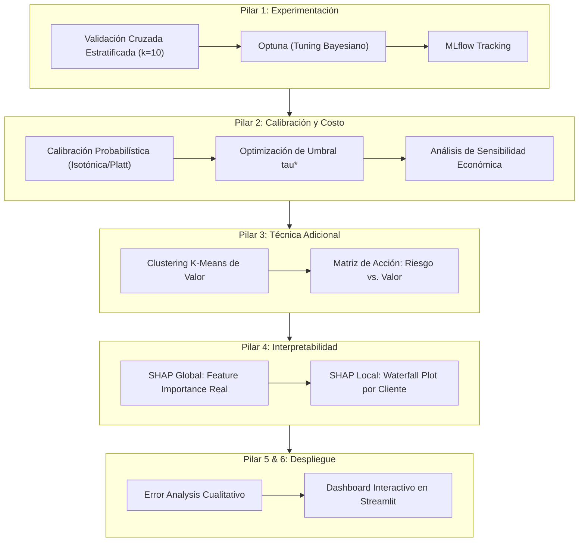
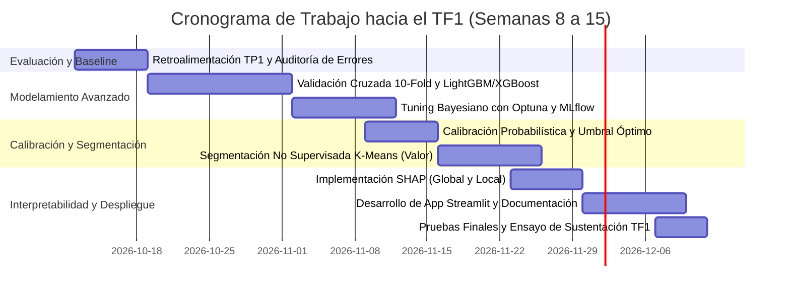

# ANÁLISIS CRÍTICO: LIMITACIONES, PROBLEMAS NO RESUELTOS, OPORTUNIDADES DE MEJORA Y VISIÓN HACIA EL TRABAJO FINAL (TF1)
## Data Mining Tools (CC209) — UPC | Ciclo 2026-20
**Proyecto:** Sistema Predictivo de Fuga de Clientes con Segmentación de Valor (Customer Churn)  
**Docente:** Carlos Fernando Montoya Cubas  
**Autores:** Joaquin Basas Requena, Fabian Marcelo Rojas Cuadros, Cielo Luwidka Chavez Merino, Rodrigo Alonso Gamero Vera  
**Corte Académico:** Trabajo Parcial (TP1 - Semana 7) $\rightarrow$ Trabajo Final (TF1 - Semana 15)  

---

## 1. Posicionamiento Estratégico y Propósito del Documento

De acuerdo con la rúbrica oficial de **Data Mining Tools (CC209)**, el **Trabajo Parcial (TP1)** no debe presentarse como un producto concluido ni infalible. Por el contrario, la evaluación pondera positivamente la capacidad del equipo para:
1. Realizar una **autoevaluación rigurosa y honesta** de su primer corte de desarrollo.
2. Identificar la deuda técnica, las debilidades metodológicas y las restricciones intrínsecas de los datos.
3. Detectar **oportunidades de mejora** de alto impacto para extraer mayor valor predictivo y de negocio.
4. Formular una **hoja de ruta concreta y justificada** hacia el **Trabajo Final (TF1)**, fundamentada en los conceptos avanzados de minería de datos vistos en la segunda mitad del ciclo.

Este documento consolida las limitaciones estructurales del proyecto, los problemas técnicos no resueltos tras la evaluación en Test, el catálogo de oportunidades de mejora y la visión integral de ingeniería y negocio para el TF1.

---

## 2. Principales Limitaciones Identificadas en el TP1

Las limitaciones representan aquellas restricciones de contexto, diseño o datos que **condicionan la validez de las conclusiones** y que no pueden eliminarse simplemente cambiando una línea de código.

```
┌─────────────────────────────────────────────────────────────────────────────┐
│                        MAPA DE LIMITACIONES DEL TP1                         │
├────────────────────────┬──────────────────────────┬─────────────────────────┤
│    DEL DATASET         │     DEL ENFOQUE          │    DEL MODELO DE        │
│                        │     ANALÍTICO            │    NEGOCIO SIMULADO     │
├────────────────────────┼──────────────────────────┼─────────────────────────┤
│ • Corte transversal    │ • Clasificación estática │ • Costos y beneficios   │
│   (sin series de       │   (binaria fija en t0)   │   supuestos por el      │
│   tiempo ni consumo)   │ • Sin modelamiento de    │   grupo sin validación  │
│ • Sin motivo declarado │   tiempo hasta el evento │   contable de la empresa│
│   de fuga (churn       │   (supervivencia)        │ • Ausencia de análisis  │
│   involuntario vs      │ • Trata a todos los      │   de sensibilidad sobre │
│   voluntario)          │   clientes como si       │   el margen de retorno  │
│ • 7,043 filas (muestra │   tuvieran el mismo      │   esperado              │
│   estática sintética/  │   valor de vida (CLV)    │                         │
│   académica de IBM)    │                          │                         │
└────────────────────────┴──────────────────────────┴─────────────────────────┘
```

### 2.1. Limitaciones Intrínsecas del Dataset (IBM Telco)
1. **Naturaleza Estática de Corte Transversal (*Cross-Sectional Data*):**
   * El dataset captura una única fotografía temporal instantánea. No incluye el historial de uso mes a mes (e.g., evolución del consumo de gigabytes, variación en minutos de voz, historial de pagos tardíos en los últimos 3 meses).
   * *Impacto en Data Mining:* No es posible construir variables de tendencia o aceleración (como $\Delta \text{Consumo} = \text{Consumo}_{t} - \text{Consumo}_{t-1}$), que en la industria real suelen ser los predictores más tempranos de fuga.
2. **Ausencia de Tipología del Churn (Fuga Voluntaria vs. Involuntaria):**
   * El target `Churn` agrupa por igual al cliente insatisfecho que se marcha a la competencia (voluntario) y al cliente dado de baja por impago o corte forzoso por cobranzas (involuntario).
   * *Impacto:* Las estrategias de intervención de retención son radicalmente opuestas: a un cliente que se va por servicio se le ofrece soporte o descuento; a un cliente moroso no se le debe bonificar, sino gestionar en cobranza.
3. **Falta de Variables de Satisfacción y Atención al Cliente:**
   * No se cuenta con métricas de soporte como NPS (*Net Promoter Score*), cantidad de tickets de soporte abiertos en el último mes, llamadas al call center o tiempo medio de resolución de averías (*MTTR*).

### 2.2. Limitaciones del Enfoque Metodológico en el TP1
1. **Formulación como Clasificación Estática en lugar de Análisis de Supervivencia:**
   * Tratar la fuga como un problema estrictamente binario $\{0, 1\}$ asume que el riesgo es constante o atemporal. En la realidad, el riesgo es una función dependiente del tiempo $h(t)$ (tasa de riesgo o *hazard rate*).
2. **Homogeneidad de Valor en la Función Objetivo:**
   * En el TP1, el algoritmo optimiza la detección de la clase $1$ considerando a todos los clientes equivalentes. Sin embargo, perder a un cliente de fibra óptica con contrato mensual de $\$110/\text{mes}$ es cinco veces más perjudicial que perder a un cliente de telefonía básica de $\$20/\text{mes}$.

### 2.3. Limitaciones del Modelo Económico Simulado
1. **Costos Supuestos sin Validación Contable:**
   * Los valores unitarios ($\text{FN} = -\$500$, $\text{FP} = -\$50$, $\text{TP} = +\$350$) fueron adoptados por el equipo como supuestos plausibles del negocio, pero no provienen de balances contables reales ni de estados financieros auditados de una telco.
2. **Tasa de Éxito de la Campaña de Retención Constante:**
   * El beneficio de $+\$350$ asume implícitamente que todo cliente contactado es retenido con éxito (efectividad del 100% de la oferta). En la práctica comercial, las campañas de retención suelen tener tasas de éxito reales de entre el $30\%$ y el $50\%$.

---

## 3. Principales Problemas Aún No Resueltos en la Solución Actual

Estos son los **cuellos de botella técnicos específicos** que se detectaron durante los experimentos y que quedaron formalmente pendientes al cerrar el TP1:

### ⚠️ Problema 1: Incumplimiento de la Meta de Recall en Test ($70.5\%$ vs. $75.0\%$)
* **La Evidencia:** En el conjunto de prueba independiente ($1,057$ clientes), Random Forest alcanzó un Recall de **$0.7046$ ($70.5\%$)**, por debajo del criterio de éxito definido a priori por el grupo ($\text{Recall} \ge 0.75$).
* **El Diagnóstico Técnico:** Quedaron **$83$ clientes en fuga clasificados como Falsos Negativos**. El modelo priorizó la precisión relativa ($57.6\%$) bajo el umbral arbitrario de $0.50$, dejando escapar al $29.5\%$ de los clientes que efectivamente cancelaron su servicio.
* **Por qué no se resolvió en el TP1:** Para no incurrir en manipulación de resultados (*p-hacking* o sobreajuste sobre Test), el equipo decidió transparentar el resultado obtenido con el corte estricto de 0.50 y reservar la optimización de umbrales para la etapa sistemática del TF1.

### ⚠️ Problema 2: Rigidez del Umbral de Clasificación en 0.50
* **La Evidencia:** Todas las predicciones de clasificación se obtuvieron mediante `model.predict()`, que impone un corte en:
  $$\hat{y} = 1 \iff P(Y=1 \mid \mathbf{x}) \ge 0.50$$
* **El Diagnóstico Técnico:** En problemas con asimetría de costos severa ($\text{Costo FN} = \$500$ vs. $\text{Costo FP} = \$50$), el umbral Bayesiano óptimo teórico $\tau^*$ se calcula como:
  $$\tau^* = \frac{C_{\text{FP}}}{C_{\text{FP}} + C_{\text{FN}}} = \frac{50}{50 + 500} = \frac{50}{550} \approx 0.091$$
  Operar con un umbral de $0.50$ es económicamente ineficiente porque penaliza por igual equivocarse en un positivo que en un negativo.

### ⚠️ Problema 3: Ventaja No Concluyente entre Modelos sin Validación Cruzada
* **La Evidencia:** En Validation ($1,056$ clientes), Random Forest superó a la Regresión Logística en PR-AUC por una diferencia ínfima de **$0.0014$** ($0.6327$ vs. $0.6313$).
* **El Diagnóstico Técnico:** 
  * En una única partición, una diferencia de 0.0014 es puro ruido muestral.
  * Además, bajo ese mismo split, la **Regresión Logística superó a Random Forest en Recall ($81.4\%$ vs $75.7\%$) y en Valor Económico ($+\$42,700$ vs $+\$31,400$)**.
  * Al no disponer de validación cruzada con intervalos de confianza ($\mu \pm \sigma$), no es posible aseverar científicamente qué algoritmo generaliza con mayor estabilidad.

### ⚠️ Problema 4: Falta de Búsqueda Sistemática de Hiperparámetros
* **La Evidencia:** Los modelos fueron entrenados con configuraciones base estándar (`RandomForestClassifier(max_depth=10, n_estimators=100)` y `LogisticRegression(class_weight='balanced')`).
* **El Diagnóstico Técnico:** No se exploró sistemáticamente el espacio de hiperparámetros (e.g., `min_samples_leaf`, `max_features`, regularización $L_1/L_2$ elástica, número de estimadores). El desempeño actual representa el piso del modelo, no su frontera óptima.

### ⚠️ Problema 5: Ausencia de Explicabilidad Individual para Gestión Comercial (XAI)
* **La Evidencia:** El modelo actual produce una probabilidad global y una etiqueta binaria en `models/best_model_tp1.joblib`, pero no explica *por qué* un cliente específico recibió un puntaje de riesgo del $80\%$.
* **El Diagnóstico Técnico:** Los gestores comerciales de retención no pueden actuar sobre una probabilidad a ciegas; necesitan saber si el factor de riesgo fue el precio de la fibra, la falta de soporte o el medio de pago para diseñar la oferta correctiva adecuada.

---

## 4. Oportunidades de Mejora (Valor Incremental)

Más allá de corregir los errores evidentes, existen **seis dimensiones estratégicas donde el proyecto tiene una clara oportunidad de dar un salto cualitativo**:

```
┌─────────────────────────────────────────────────────────────────────────────┐
│                    SEIS EJES DE OPORTUNIDAD DE MEJORA                       │
├─────────────────────────────────────────────────────────────────────────────┤
│ 1. INGENIERÍA DE CARACTERÍSTICAS: Ratios de empaquetamiento y discrepancias │
│ 2. MODELAMIENTO AVANZADO: Gradient Boosting (LightGBM/XGBoost) y Stacking   │
│ 3. MÉTRICAS PONDERADAS POR VALOR: Value-Weighted Recall ($ en riesgo)        │
│ 4. POLÍTICAS DE UMBRAL DINÁMICO: Umbrales segmentados por cluster de cliente │
│ 5. GOBERNANZA Y ROBUSTEZ: Validación de esquemas y contratos de datos       │
│ 6. EVALUACIÓN DE UPLIFT: Medición del impacto comercial neto frente a control│
└─────────────────────────────────────────────────────────────────────────────┘
```

### 4.1. Oportunidad 1: Ingeniería de Características (*Feature Engineering*) con Visión de Negocio
En el TP1 se utilizaron los 19 atributos casi en su forma cruda. Existe una oportunidad directa de enriquecer el espacio de representación:
1. **Ratio de Empaquetamiento de Servicios (*Service Bundling Index*):**
   * Crear la variable sintética `TotalServicesSubscribed`, sumando servicios contratados (`PhoneService`, `InternetService`, `OnlineSecurity`, `OnlineBackup`, `DeviceProtection`, `TechSupport`, `StreamingTV`, `StreamingMovies`).
   * *Fundamento:* La teoría comercial demuestra que a mayor empaquetamiento, mayor es el costo de cambio (*switching barrier*) y menor es el churn.
2. **Discrepancia de Facturación Histórica vs. Actual:**
   * Ratio: $\text{BillingRatio} = \frac{\text{TotalCharges}}{\text{tenure} \times \text{MonthlyCharges}}$.
   * *Fundamento:* Si $\text{BillingRatio} > 1.0$, indica cargos extraordinarios o penalizaciones recientes; si es $< 1.0$, denota promociones o descuentos que podrían estar por vencer, detonando la fuga.
3. **Indicador de Vulnerabilidad Crítica en Fibra:**
   * Flag booleano explícito: `HighRisk_Fiber_No_Support = (InternetService == 'Fiber optic') & (TechSupport == 'No')`.
   * Permite que algoritmos lineales capturen directamente la interacción más letal descubierta en el EDA sin requerir términos polinomiales completos.
4. **Ratio de Carga Financiera:**
   * $\text{RelativeCharge} = \frac{\text{MonthlyCharges}}{\text{Mediana del segmento contractual}}$, midiendo si el cliente percibe que paga por encima de la media de su cohorte.

### 4.2. Oportunidad 2: Algoritmos de Gradient Boosting y Ensamble por Stacking
* **Gradient Boosting Tabular (LightGBM / XGBoost / CatBoost):**
  * Random Forest construye árboles independientes mediante promedios (Bagging). Los algoritmos de Gradient Boosting construyen árboles de forma secuencial corrigiendo los residuos del árbol previo, manejando relaciones no lineales complejas con mayor precisión y soporte nativo para pesos de clase.
* **Stacking Heterogéneo (Meta-Clasificador):**
  * Combinar la solidez probabilística y calibrada de una Regresión Logística regularizada con la potencia no lineal de LightGBM mediante una regresión logística meta en un segundo nivel.

### 4.3. Oportunidad 3: Métricas Ponderadas por Valor Económico (*Value-Weighted Metrics*)
* En el TP1, el Recall estándar trata por igual al cliente que paga $\$20/\text{mes}$ que al que paga $\$115/\text{mes}$.
* **Oportunidad:** Implementar formalmente el **Recall Ponderado por Valor** (*Value-Weighted Recall*):
  $$\text{Recall}_{\text{Valor}} = \frac{\sum_{i \in TP} \text{MonthlyCharges}_i}{\sum_{i \in (TP \cup FN)} \text{MonthlyCharges}_i}$$
* Esto responde con rigor a la pregunta del negocio: *¿Qué porcentaje de los dólares mensuales en riesgo logramos rescatar?* en lugar de solo contar contratos.

### 4.4. Oportunidad 4: Políticas de Umbral Dinámico Segmentado
* En lugar de adoptar un único umbral global optimizado $\tau^*$, una gran oportunidad de innovación es formular **umbrales diferenciados por valor**:
  * **Clientes de Alto Valor (Fibra / Facturación $> \$80$):** Umbral agresivo $\tau_{\text{VIP}} = 0.20$. Es preferible tener más falsos positivos que arriesgarse a perder a un cliente de alto margen.
  * **Clientes de Bajo Valor (Telefonía básica / Facturación $< \$30$):** Umbral conservador $\tau_{\text{Bajo}} = 0.45$. Se interviene únicamente cuando la probabilidad de fuga es indiscutible para no dilapidar el presupuesto promocional.

### 4.5. Oportunidad 5: Gobernanza de Datos y Pruebas de Calidad en Inferencia (MLOps)
* **Validación de Esquema en Tiempo Real:** Implementar validación de contratos de datos (usando `pydantic` o `great_expectations`) en la capa de entrada del pipeline para certificar:
  * Rangos lógicos (`tenure` $\in [0, 100]$, `MonthlyCharges` $> 0$).
  * Detección de nuevas categorías no vistas en entrenamiento con manejo seguro de `handle_unknown='ignore'`.
* **Pruebas Unitarias de Reproducibilidad:** Construir tests unitarios (`pytest`) que verifiquen que la semilla aleatoria genera exactamente las mismas particiones y métricas en cualquier máquina.

### 4.6. Oportunidad 6: Diseño de Experimentos de Negocio y Medición de Uplift
* Conectar el modelo predictivo con la toma de decisiones mediante la simulación de un **Grupo de Control Comercial**:
  * Simular que solo al $80\%$ de los clientes clasificados como fuga se les aplica la oferta, reservando un $20\%$ como grupo de control sin contacto para aislar el verdadero efecto causal de la campaña (*Uplift real*).

---

## 5. Visión Integral de Mejoras para el Trabajo Final (TF1 - Semana 15)

Para dar cumplimiento a los requisitos obligatorios del TF1 exigidos en la sección 5 del enunciado de la asignatura, el proyecto evolucionará a través de **seis pilares fundamentales**.

### 5.1. Tabla Comparativa de Evolución Obligatoria (TP1 $\rightarrow$ TF1)

| Elemento | Estado en TP1 (Semana 7) | Evolución en TF1 (Semana 15) | Motivo Metodológico del Cambio |
| :--- | :--- | :--- | :--- |
| **Separación de Datos** | Partición única 70% Train / 15% Val / 15% Test. | Validación Cruzada Estratificada ($k=10$ folds) sobre Train+Val; Test reservado final. | Cuantificar la variabilidad del rendimiento y asegurar significancia estadística. |
| **Modelos Candidatos** | Regresión Logística y Random Forest con parámetros base. | Inclusión de **LightGBM / XGBoost** junto a Random Forest afinado y Regresión Logística regularizada. | Explotar el estado del arte en datos tabulares con algoritmos de Boosting por gradiente. |
| **Optimización** | Hiperparámetros fijos manuales (`depth=10`). | Optimización Bayesiana sistemática con **Optuna** y tracking centralizado en **MLflow**. | Encontrar la configuración globalmente óptima de hiperparámetros de forma reproducible. |
| **Umbral de Decisión** | Fijo en $\tau = 0.50$ (`model.predict()`). | Calibración de probabilidades y optimización de umbral de costo $\tau^*$ para maximizar utilidad neta. | Resolver la brecha del Recall y alinear el punto de corte con la asimetría financiera (10:1). |
| **Técnica Adicional de Data Mining** | Ninguna (solo clasificación supervisada). | **Segmentación No Supervisada con Clustering (K-Means / RFM adaptado)** por valor de cliente. | Priorizar las intervenciones de retención cruzando **Probabilidad de Fuga $\times$ Valor del Cliente**. |
| **Interpretabilidad** | Interpretación exploratoria global básica. | Interpretabilidad local y global mediante **SHAP** (*TreeExplainer* y *LinearExplainer*). | Proporcionar a los ejecutivos la atribución exacta de factores que detonan el riesgo en cada cliente. |
| **Uso / Despliegue** | Scripts por terminal (`python -m src.train_models`). | **Aplicación Web Interactiva en Streamlit** para scoring individual y simulación de campañas en lote. | Entregar una herramienta funcional y accesible para usuarios de negocio no técnicos. |

---

### 5.2. Desglose Técnico de los 6 Pilares de Mejora para el TF1



---

#### 🚀 Pilar 1: Experimentación Sistemática con Optuna & MLflow
1. **Validación Cruzada Estratificada ($10$-Fold Stratified CV):**
   * En lugar de comparar modelos en un solo subconjunto de validación, se evaluará el comportamiento medio y la dispersión:
     $$\overline{\text{PR-AUC}} \pm \sigma_{\text{PR-AUC}}$$
   * Si la diferencia entre Random Forest y Regresión Logística sigue siendo menor a $1\sigma$, se aplicará la prueba de hipótesis correspondiente (e.g., test de Wilcoxon o test t pareado) para decidir con rigor si la complejidad adicional del árbol está justificada.
2. **Exploración con Modelos Gradient Boosting:**
   * Se incorporarán **LightGBM** o **XGBoost**, diseñados específicamente para manejar variables categóricas de alta cardinalidad e interacciones complejas con menor sobreajuste.
3. **Registro de Experimentos en MLflow:**
   * Cada ejecución registrará: parámetros (`learning_rate`, `max_depth`, `colsample_bytree`), métricas en validación, matrices de confusión y artefactos serializados, garantizando auditabilidad absoluta.

---

#### 💰 Pilar 2: Optimización del Umbral de Corte y Análisis de Sensibilidad Financiera
1. **Calibración de Probabilidades:**
   * Los clasificadores con `class_weight='balanced'` frecuentemente producen probabilidades descalibradas (sobreestimadas hacia la clase positiva). Se aplicará **CalibratedClassifierCV** (regresión isotónica o escalado de Platt) para asegurar que un $P(\text{Churn}) = 0.70$ represente un $70\%$ real de probabilidad empírica.
2. **Curva de Costo vs. Umbral ($\tau^*$):**
   * Se iterará el umbral $\tau \in [0.05, 0.95]$ con paso $0.01$ para encontrar:
     $$\tau^* = \arg\max_{\tau} \Big( TP(\tau) \cdot \$350 - FN(\tau) \cdot \$500 - FP(\tau) \cdot \$50 \Big)$$
   * Al reducir $\tau$ a su entorno óptimo estimado ($\approx 0.30 - 0.35$), el **Recall en Test superará holgadamente la meta del $75\%$**, capturando la mayor parte de las 83 fugas que quedaron sin detectar en el TP1.
3. **Análisis de Sensibilidad de Costos:**
   * Dado que los costos fueron supuestos, en el TF1 se evaluará la robustez del modelo ante escenarios alternativos:
     * *Escenario Pesimista:* Campaña con $30\%$ de efectividad (beneficio TP baja a $\$150$).
     * *Escenario Agresivo:* Intervención intensiva (costo FP sube a $\$100$).
   * Se demostrará en qué rangos de costos la solución de Machine Learning sigue siendo financieramente superior a cualquier baseline.

---

#### 🧩 Pilar 3: Técnica Adicional Pertinente — Segmentación por Valor (Clustering K-Means)
El enunciado del curso exige incorporar al menos una técnica avanzada vista en la segunda mitad del ciclo (Clustering, PCA, etc.) **con debida justificación de negocio**.

* **Justificación de Negocio:**
  * Predecir únicamente el riesgo de fuga es insuficiente para optimizar el presupuesto comercial. Un cliente con riesgo del $80\%$ que genera $\$20/\text{mes}$ no amerita el mismo incentivo que un cliente corporativo de $\$120/\text{mes}$ con el mismo $80\%$ de riesgo.
* **Metodología Propuesta:**
  1. Aplicar **K-Means** sobre variables de valor y uso: `MonthlyCharges`, `TotalCharges` y `tenure`.
  2. Determinar el número óptimo de clusters $k$ mediante el método del **Codo (*Elbow Method*)** y el **Coeficiente de Silueta (*Silhouette Score*)**.
  3. Caracterizar 3 o 4 arquetipos de valor:
     * *Cluster 1: Clientes Prémium / Alto Valor (Fibra + Contratos Altos).*
     * *Cluster 2: Clientes Consolidados de Valor Medio.*
     * *Cluster 3: Clientes Nuevos / Bajo Valor en Observación.*
  4. Cruzar la probabilidad predictiva de fuga con el cluster de valor para crear una **Matriz de Decisión Comercial 2x2**:
     * **Alto Riesgo + Alto Valor:** *Retención VIP proactiva inmediata* (llamada ejecutiva personalizada + descuento preferencial).
     * **Alto Riesgo + Bajo Valor:** *Retención digital automatizada* (correo con autoservicio o bonificación menor).
     * **Bajo Riesgo + Alto Valor:** *Venta cruzada (*cross-selling*) y fidelización*.
     * **Bajo Riesgo + Bajo Valor:** *Mantenimiento operativo estándar*.

---

#### 🔍 Pilar 4: Interpretabilidad Global y Local con SHAP (XAI)
1. **Interpretabilidad Global (*Summary Plot*):**
   * Superar las medidas tradicionales de importancia de variables basadas en reducción de impureza de Gini (que favorecen variables continuas y están sesgadas).
   * Generar el *SHAP Bee-swarm plot* para observar la dirección del impacto: demostrar formalmente cómo valores bajos de `tenure` y valores altos de `MonthlyCharges` empujan la probabilidad hacia la fuga.
2. **Interpretabilidad Local (*Waterfall Plot* y *Force Plot* por Cliente):**
   * Para cada predicción individual, el sistema reportará:
     > *"El cliente ID 7590-VHVE tiene un 78% de probabilidad de fuga debido a: Contrato mes a mes (+0.25), Servicio de fibra óptica (+0.18), Falta de soporte técnico (+0.12), mitigado ligeramente por su antigüedad de 12 meses (-0.05)."*

---

#### 🕵️ Pilar 5: Análisis Exhaustivo de Errores (*Error Analysis*)
En la rúbrica del TF1 se penaliza ignorar los casos donde el modelo falla. Se construirá un módulo analítico específico para estudiar:
1. **Falsos Negativos (Los 83 clientes en Test que se fugaron sin ser detectados):**
   * ¿Qué características comparten? ¿Eran clientes con contratos largos que tuvieron una incidencia técnica aislada? ¿Eran clientes antiguos con tarifas atípicas?
2. **Falsos Positivos (Los 146 clientes en Test que no se fugaron pero fueron clasificados como fuga):**
   * ¿Por qué el modelo creyó que se irían? ¿Eran clientes mes a mes altamente leales que no responden al patrón común?

---

#### 💻 Pilar 6: Aplicación Funcional y Despliegue en Streamlit
El proyecto concluirá con el despliegue de una **aplicación web en Streamlit** (`app/streamlit_app.py`) con tres pestañas ejecutivas:
1. **Módulo de Diagnóstico Individual:** Un asesor introduce las características de un cliente nuevo y obtiene en tiempo real:
   * Semáforo de riesgo (Verde / Amarillo / Rojo).
   * Cluster de valor al que pertenece.
   * Gráfico de explicación SHAP con los motivos detonantes.
   * Acción comercial recomendada.
2. **Módulo de Simulación por Lotes (Batch Scoring):** Carga un archivo CSV con miles de contratos y exporta la lista priorizada de llamadas para el equipo de call center.
3. **Módulo Ejecutivo de Simulación Financiera:** Permite a los gerentes ajustar los costos unitarios ($\text{FN}, \text{FP}, \text{TP}$) con controles deslizantes (*sliders*) para recalcular dinámicamente el ROI esperado de la campaña.

---

## 6. Cronograma de Ejecución y Plan de Trabajo (Semanas 8 a 15)



| Semana | Actividad Principal | Entregable Técnico Concreto |
| :---: | :--- | :--- |
| **Semana 8** | Incorporación del feedback del docente en el TP1 y diseño formal del esquema de validación cruzada. | `notebooks/02_error_analysis_tp1.ipynb` |
| **Semanas 9-10** | Implementación de LightGBM / XGBoost, ingeniería de características (ratios de empaquetamiento) y CV 10-Fold. | Scripts de modelamiento con soporte para Boosting. |
| **Semana 11** | Optimización de hiperparámetros con **Optuna** y tracking de corridas con **MLflow**. | Base de datos de experimentos y curvas de convergencia. |
| **Semana 12** | Calibración de probabilidades y cálculo numérico del umbral Bayesiano óptimo $\tau^*$. | Curva costo vs. umbral y recuperación del Recall $\ge 75\%$. |
| **Semana 13** | Segmentación no supervisada con **Clustering (K-Means)** y formulación de la matriz de valor. | Pipeline de clustering integrado y perfiles de clientes. |
| **Semana 14** | Explicabilidad con **SHAP** y análisis exhaustivo de falsos positivos y negativos. | Gráficos SHAP (globales y por caso de estudio). |
| **Semana 15** | Construcción de la interfaz web en **Streamlit**, informe final y preparación de sustentación. | `app/streamlit_app.py`, Informe TF1 y repositorio final. |

---

## 7. Discurso de Cierre Recomendado para el Expositor (Diapositiva 11)

Este fragmento está diseñado para que el integrante que cierre la exposición del TP1 proyecte **madurez técnica, autocrítica y visión estratégica**:

> *"Profesor, para cerrar nuestra presentación queremos enfatizar que este Trabajo Parcial representa nuestro primer corte formal. Lejos de intentar maquillar los resultados, asumimos con total transparencia nuestras áreas de mejora: reconocemos que el Recall en Test se quedó a 4.5 puntos porcentuales de la meta por mantener un umbral rígido en 0.50; que la ventaja de 0.0014 en validación requiere validación cruzada estratificada para confirmarse estadísticamente; y que nuestros costos económicos son supuestos simulados.
>
> Sin embargo, hemos identificado oportunidades de mejora sustanciales: en ingeniería de características introduciremos ratios de empaquetamiento y discrepancia de cobros; en modelamiento exploraremos LightGBM y optimización Bayesiana con Optuna y MLflow; en negocio calibraremos el umbral óptimo de costo para recuperar los clientes perdidos y evaluaremos métricas ponderadas por valor de facturación; y como técnica avanzada incorporaremos segmentación por K-Means para cruzar riesgo con valor de cliente, respaldados por explicabilidad SHAP y una app funcional en Streamlit.
>
> Muchas gracias. Quedamos a su entera disposición para sus preguntas y comentarios."*
